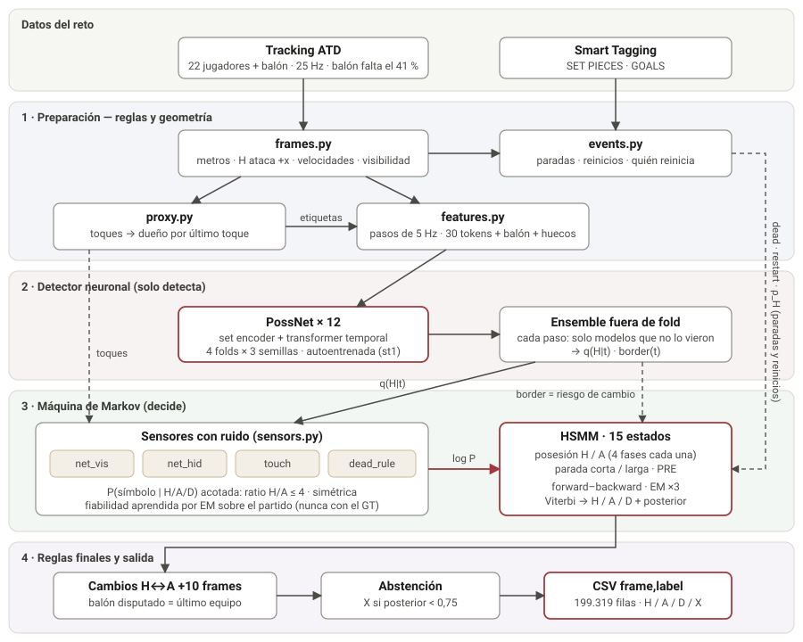

# possession — More than a Hack 2027, phase 1

Frame-level ball possession (`H` home / `A` away / `D` dead ball) for FC Barcelona – Athletic Club
from the automatic tracking data.

**A network that detects and a football state machine that decides.** A set + temporal
transformer (PossNet) reads 30 s of play and says which team *seems* to have the ball and where a
change *seems* to happen. It never writes a label: its outputs, the touch detector, the dead-ball
rules and the broadcast picture are bounded noisy sensors of a hidden semi-Markov machine
(possession H / A with explicit durations, short / long stoppages, restarts), which picks the most
coherent story with Viterbi. The network is then retrained on the machine's own confident
decisions (self-training).

| | spellF1 | macroF1 |
|---|---|---|
| Official baseline (full match) | 0.243 | — |
| **This system** (public 5 min, official evaluator) | **0.667** | **0.931** |

The public 5 minutes are 17 possessions (bootstrap interval of the spellF1: 0.45–0.87) and the
easiest stretch of the match, so the system is also checked over the whole match without ground
truth: `python scripts/check_match.py --csv outputs/<name>.csv`.



## Setup (Windows, Python 3.12)

```powershell
py -3.12 -m venv .venv
.\.venv\Scripts\python -m pip install torch --index-url https://download.pytorch.org/whl/cu126
.\.venv\Scripts\python -m pip install -r requirements.lock
.\.venv\Scripts\python -m pip install -e .
```

**No match data is in this repository.** Point it at the challenge repository (data bundle +
official evaluator): by default `../more-than-a-hack-2027` (`configs/paths.yaml`), or set
`MTAH_ROOT`. Both the tactical and the broadcast folders of the bundle are read.

## Reproduce the submission (no training, no GPU needed)

```bash
python -m possession.pipeline --name <team_name> --rebuild --expect $(cat SUBMISSION.sha256)
python ../more-than-a-hack-2027/evaluation/validate_submission.py outputs/<team_name>.csv
```

`--rebuild` rebuilds every cache from the raw data; then the committed weights (`models/st1/`,
12 × `best.pt`) run as an out-of-fold ensemble, the machine decodes, and the final rules are
applied. `--expect` stops the run with an error if the CSV is not the submitted one
(`SUBMISSION.sha256`).

- The networks run **on the CPU in double precision** (about 8 minutes). That is the reference
  path: GPU inference with mixed precision (`--device cuda`) gives the same public score but a
  file that differs in a few hundred rows.
- `bash scripts/repro_check.sh` does the same from a clean copy of the published files only
  (checked: it regenerates the submitted file byte for byte, about 9 minutes).
- `python scripts/package_submission.py "<team name>" outputs/<team_name>.csv` copies the verified CSV
  to `outputs/entrega/` under the team's name, as the form asks.
- Earlier candidates: `--min-stop 0 --tag-ext 0` (broadcast sensor without the stoppage-edge rules,
  sha256 `1609bdd8b253714d9be74cb0c1ec2a83044a470e7f308748b586799bbd032a9b`) and, on top of that,
  `--broadcast off` (sha256 `2141e584721dffa4285d50773979c31f76936aa24189f342bbb570762b4e7532`).

## Retrain from scratch (~3 h on a 4 GB GPU)

```bash
bash scripts/train_from_scratch.sh
```

Rule labels → PossNet v3 (4 folds × 3 seeds) → the machine labels the match → self-trained
PossNet st1 (4 folds × 3 seeds) → CSV. GPU training is not deterministic, which is why the
weights are committed: the result is statistically equivalent, not bit-identical.

## Pipeline

| Stage | Module | Command | Output |
|---|---|---|---|
| Geometry | `frames.py` | `python -m possession.frames` | `cache/t0_frames.npz` |
| Broadcast on the tactical timeline | `sync.py` | `python -m possession.sync` | `cache/t0_broadcast.npz` |
| Stoppages, restarts | `events.py` | `python -m possession.events` | `cache/t1_events.npz` |
| Touches, last-touch labels | `proxy.py` | `python -m possession.proxy` | `cache/t1_proxy.npz` |
| 5 Hz steps | `features.py` | `python -m possession.features` | `cache/t0_steps.npz` |
| Train one network | `train.py` | `python -m possession.train --fold 0 --seed 0 [--steps <labels>]` | `runs/<stamp>_<name>/` |
| Out-of-fold ensemble from weights | `infer.py` | `python -m possession.infer --models models/st1` | `outputs/infer_oof_ensemble.npz` |
| Everything | `pipeline.py` | `python -m possession.pipeline --name <name>` | `outputs/<name>.csv` |
| Acceptance report | `audit.py` | `python scripts/check_match.py --csv outputs/<name>.csv` | printed |

## Repository layout

```
src/possession/   the package (pipeline, rules, network, sensors, machine, sync, audit)
models/st1/       the 12 submitted networks (best.pt + config.json)
configs/          paths and network configuration
scripts/          pipeline wrappers, training batches, checks, docs builder
docs/             architecture documentation, diagrams, technical document
tests/            unit tests (no match data needed) + data-hygiene guard
SUBMISSION.sha256 the hash of the submitted CSV
```

## Use of the public ground truth

Only for choosing between variants and for scalar hyperparameters (the machine's, and the 2.5 s
lead and initial matrix of the broadcast sensor). It is never a training target, the public window
is excluded from every training fold, and the machine's EM never reads it. With 17 public
possessions, differences below ~0.04 are noise: early steps were kept only when they held paired
over many networks, and the last two (the broadcast sensor and the stoppage-edge rules) were judged
on whole-match criteria fixed beforehand instead of on the public score.

## Tests and data hygiene

```bash
python -m pytest -q
```

- `tests/test_machine.py`: the state machine and its sensors (topology, Coxian phases, transitions
  sum to one, Viterbi, bounded sensors, the turnover-delay rule, the broadcast sensor, the
  stoppage-edge rules).
- `tests/test_sync.py`: broadcast alignment on synthetic tracks.
- `tests/test_audit.py`: the acceptance report.
- `tests/test_pipeline_cli.py`: file hash, device and precision; one test guards the PyTorch
  attention fast path, which silently removes the network's temporal context in inference mode.
- `tests/test_no_data_in_git.py` fails if a tracked file looks like match data or exceeds 5 MB.

Scripts print aggregates only.
